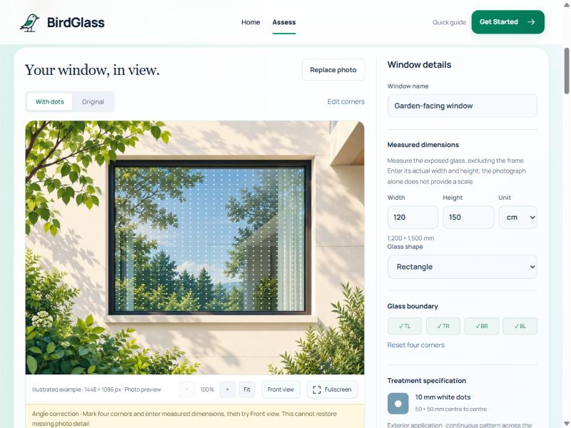
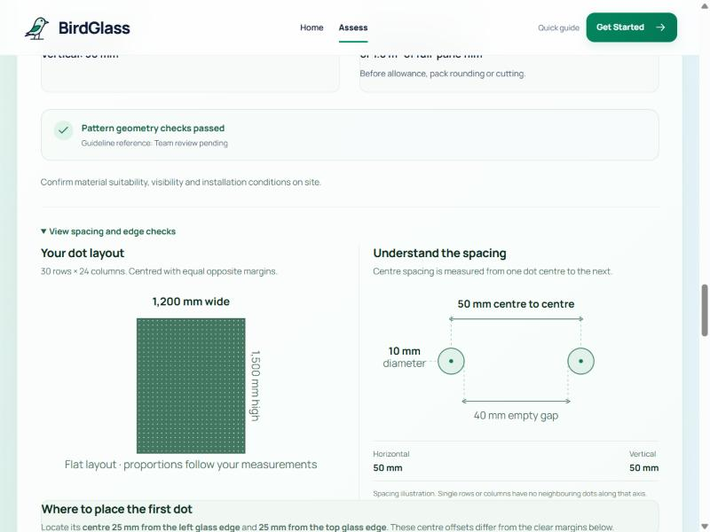
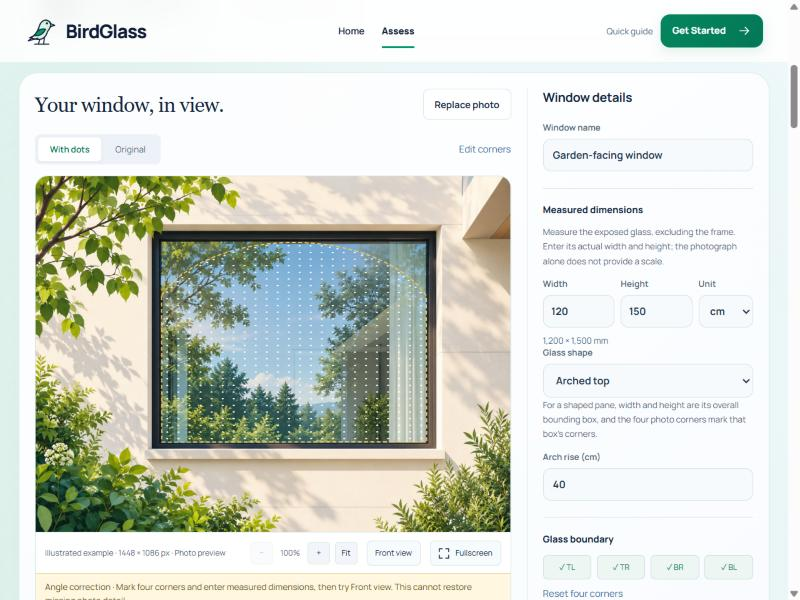
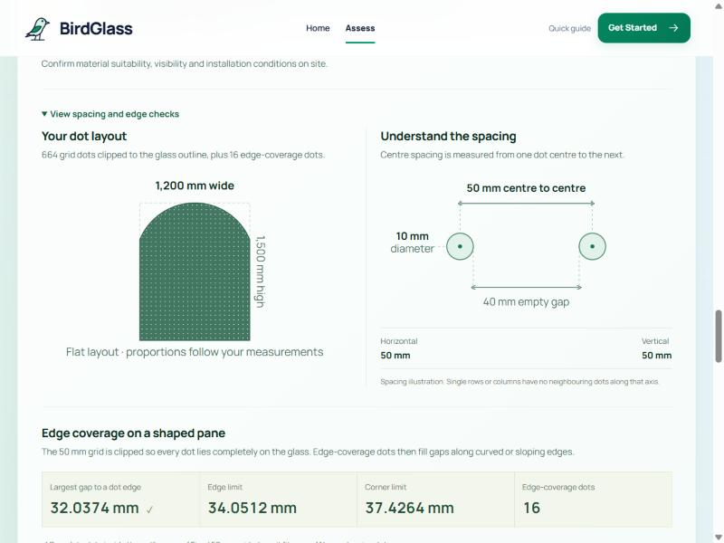
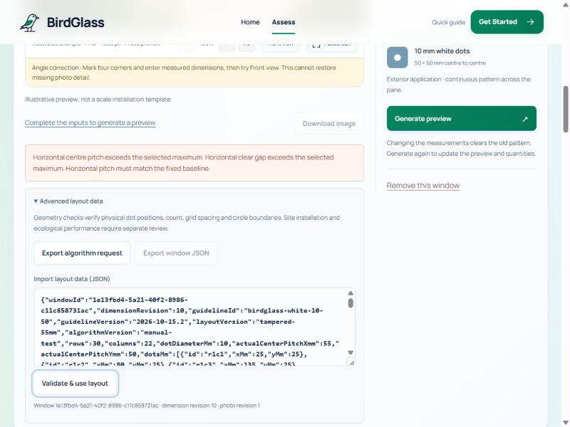

# BirdGlass Test Report (Member 3: Pattern Algorithm and Validation)

Date: 18 October 2026
Algorithm version: member3-fixed-grid-1.2.0 (previously 1.1.0)
Guideline: birdglass-white-10-50, version 2026-10-15.2 (unchanged, still marked draft)

## 1. Summary

| Item | Result |
|---|---|
| Automated tests | 468 of 468 passed, in 42 test files |
| TypeScript check | Passed |
| Production build | Passed, and `dist/` was rebuilt |
| Expected vs actual checks | 176 of 176 matched (see `docs/Member3-verification-results.json`) |
| Bugs fixed | 3 (section 8) |
| New feature | Irregular glass shapes: arched top, sloped top or triangle, and custom outline (section 4) |

To run the checks yourself:

```bash
npm ci
```
```bash
npm test
```
```bash
npm run build
```

The main checks are in `tests/member3-verification.test.ts`, and the shape checks are in `tests/irregular-shapes.test.ts`. In these tests we work out each expected value by hand from the formulas in section 3, then compare it with what the app produces. The tests do not reuse the app's own code to get the expected answer.

## 2. Pattern rules

| Rule | Value | Where in the code |
|---|---|---|
| Marker | 10 mm white round dot on the outside of the glass | `config/baseline.ts` |
| Centre spacing | Fixed at 50 mm across and down | `member3/rules.ts` |
| Gap between dots | 50 − 10 = 40 mm | worked out from the above |
| Edge rule BG-EDGE-001 (rectangles) | Gap from glass edge to dot edge is at most 25 mm on every side | `config/boundaryPolicy.ts` |
| Edge rule BG-EDGE-002 (shaped panes, new) | Every point on the glass is at most 34.05 mm from a dot edge (37.43 mm near sharp corners) | `member3/shapedPattern.ts` |
| Placement | Grid is centred with equal margins on opposite sides; only whole dots are placed on the glass | `member3/grid.ts` |
| Limits | Up to 10,000 dots per pane; each side from 10 mm to 100 m | `member2/model.ts` |

BG-EDGE-001 and BG-EDGE-002 are rules our team set for this project. They are not thresholds proven by ecological research.

## 3. Formulas

All lengths are in millimetres. W is the measured glass width and H is the measured glass height.

### Dot positions (rectangles)

- Number of columns: C = floor((W − 10) / 50) + 1
- Number of rows: R = floor((H − 10) / 50) + 1
- First dot centre: x0 = (W − (C − 1) × 50) / 2, and y0 = (H − (R − 1) × 50) / 2
- Dot in row r and column c sits at (x0 + 50c, y0 + 50r)
- Clear gap at the edge = x0 − 5. Because W − 10 = 50(C − 1) + a remainder between 0 and 50, this gap is half the remainder, so it is always under 25 mm. A rectangle always meets BG-EDGE-001.
- One more column would fit only when W is at least 50C + 10.

### Quantities

- Number of dots N = C × R for a rectangle. For a shaped pane it is the number of dots that fit inside the outline.
- Glass area = W × H / 1,000,000 m². For a shaped pane we use the area of its outline (shoelace formula).
- Square feet = m² × 10.7639104167
- One dot covers π × 5² = 78.54 mm². Total dot area = N × 78.54 mm², and the marked percentage is total dot area divided by glass area. For a large grid this comes to about 3.14%.
- Units: cm are multiplied by 10 and metres by 1000, then rounded to the nearest 0.001 mm (see bug 1 in section 8).

### Costs

- Material cost = area in sq ft × (1 + allowance %) × rate. The rate is RM7 (die-cut frosted sticker), RM9 (standard printed film) or RM12 (premium clear film). If the user enters their own price, that replaces the reference rate.
- Labour cost (film only) = area in sq ft × installation rate: DIY RM0, standard RM3.50, conservative RM5.00. Difficult access uses RM3.50 plus a separate access quote.
- Indicative subtotal = material + labour.
- Installed total = subtotal + delivery + other charges + mobilisation + access. If any required labour or access price is missing, the total is shown as unknown instead of a guess.

### Edge limits for shaped panes (BG-EDGE-002)

We took the worst case allowed on a rectangle that only just meets BG-EDGE-001 (25 mm edge gap, 50 mm spacing):

- along an edge: √(25² + 30²) − 5 = 34.05 mm
- at a corner: √(30² + 30²) − 5 = 37.43 mm

Shaped panes must meet the same limits, so they are never covered more loosely than a rectangle that passes.

## 4. How irregular shapes work (new)

1. Input. The user chooses Rectangle, Arched top (enter the rise; half the width gives a semicircle), Sloped top or triangle (choose the shorter side and its height; 0 gives a triangle), or Custom outline (a list of x, y corner points). The width and height then describe the shape's bounding box, and the four corners on the photo mark that box. An outline is rejected if it crosses itself, has no area, goes outside the box, or does not touch all four sides of the box.
2. Clipped grid. The normal centred 50 mm grid is laid over the box, and a dot is kept only if the whole 10 mm circle is on the glass.
3. Edge dots. Clipping leaves gaps along curved or sloping edges. We check points every 3 mm along the edge and in a 45 mm strip inside it. Wherever a point is further from a dot than the BG-EDGE-002 limit, one extra dot is added about 10 mm in from the edge. Extra dots keep at least 5 mm clear of other dots.
4. Separate check. The validator does not trust dot names or saved results. It checks again that every dot is fully on the glass, that no dots overlap, that no grid position that fits is missing, that the spacing values are right, and that the edges are covered within the limits.
5. Narrow areas. If part of the glass is too narrow for any whole dot (for example a very thin triangle tip), the layout fails, and the message says where.
6. Area and cost use the real outline area, not the bounding box. For example, a 1000 × 1200 mm pane with a semicircular top is 1.0927 m², not 1.2 m². Any extra film wasted when cutting curves should be added through the allowance %.

Shaped panes always show the note "Irregular-shape edge coverage uses the derived BG-EDGE-002 rule, which awaits team review."

## 5. Test cases: expected vs actual (selection)

The full list of 176 checks is in `docs/Member3-verification-results.json`.

### Task 1: Pattern generation

| Glass (W × H mm) | Aspect | Columns × rows | Dots | First centre x | Left/right gap | Result |
|---|---|---|---|---|---|---|
| 1200 × 1500 | 0.80 | 24 × 30 | 720 | 25 | 20 | Pass |
| 600 × 600 | 1.00 | 12 × 12 | 144 | 25 | 20 | Pass |
| 2400 × 900 | 2.67 | 48 × 18 | 864 | 25 | 20 | Pass |
| 305 × 1830 | 0.17 | 6 × 37 | 222 | 27.5 | 22.5 | Pass |
| 3000 × 450 | 6.67 | 60 × 9 | 540 | 25 | 20 | Pass |
| 1234.5 × 987.6 | 1.25 | 25 × 20 | 500 | 17.25 | 12.25 | Pass |
| 60 × 60 (threshold) | 1.00 | 2 × 2 | 4 | 5 | 0 | Pass |
| 59.9 × 160 (just under) | 0.37 | 1 × 4 | 4 | 29.95 | 24.95 | Pass |
| 10 × 10 (smallest) | 1.00 | 1 × 1 | 1 | 5 | 0 | Pass |
| Width changed 1200 to 1260 | | 26 columns; old layout rejected | | | | Pass |
| Arched top 1000 × 1200 (rise 500) | | clipped | 454, all on glass | | coverage within 34.05 | Pass |
| Sloped top 1500 × 1000 (right side 400) | | clipped | 438, all on glass | | within 34.05 | Pass |
| Triangle 1000 × 600 | | clipped | 132, all on glass | | within 37.43 | Pass |

We also confirmed 50 mm spacing and a 10 mm dot size in every case with more than one dot.

### Task 2: Validation

| Case | Expected | Actual | Message |
|---|---|---|---|
| Valid 1200 × 1500, draft guideline | Geometry passes, status "incomplete" | Same | Guideline awaits team review |
| Same layout, guideline marked reviewed | Status "pass" | Same | |
| Spacing changed to 55 mm | Fail | Fail | Centre spacing must remain 50 mm |
| Dots changed to 8 mm | Fail | Fail | Dot diameter must be 10 mm |
| Last column removed | Fail | Fail | Grid not centred / a column is missing |
| One middle dot removed | Fail | Fail | Not a complete rectangular grid |
| A dot moved off the glass | Fail | Fail | A dot extends outside the glass |
| Wrong dot count | Fail | Fail | Dot count does not match |
| Shaped pane: edge dot removed, grid dot removed, dot outside arch, overlapping dots, wrong outline | Fail | Fail | A specific message for each |
| Thin triangle 2000 × 60 | Fail | Fail | Glass may be too narrow near (x, y) |
| Treatment report and placement sheet | No claim of certification | None found | Report says it "does not certify collision prevention" |

Passing the geometry check and having the guideline reviewed are kept separate. "Geometry passed" only describes the dot layout. The overall status stays "incomplete" while the guideline is a draft, and the app shows both "Pattern geometry checks passed" and "Guideline reference: Team review pending".

### Task 3: Quantities (one pane entered three ways)

| Input | Dots | Area m² | Area sq ft | Dot area m² | Marked % |
|---|---|---|---|---|---|
| 1200 × 1500 mm | 720 | 1.8 | 19.375 | 0.05655 | 3.1416 |
| 120 × 150 cm | 720 | 1.8 | 19.375 | 0.05655 | 3.1416 |
| 1.2 × 1.5 m | 720 | 1.8 | 19.375 | 0.05655 | 3.1416 |
| 2.01 × 0.9 m | 738 (41 × 18) | 1.809 | 19.4719 | 0.05796 | 3.2041 |
| 91.5 × 213.4 cm | 817 | 1.9526 | 21.0177 | 0.06417 | 3.2862 |
| Arch 1000 × 1200, rise 500 | 454 | 1.0927 (matches the circle formula) | | | |

Unit check: we tried every width from 10 mm to 20 m in steps of 1 mm, entered in both cm and m. After the fix there were no differences. Before the fix, 18 sizes up to 100 m gave the wrong count, including 2.01 m.

### Task 4: Costs (1200 × 1500 mm = 19.375 sq ft)

| Material or method | Expected (by hand) | App |
|---|---|---|
| RM7 die-cut frosted | 19.375 × 7 = RM135.63 | RM135.63 |
| RM9 standard film | 19.375 × 9 = RM174.38 | RM174.38 |
| RM12 premium film | 19.375 × 12 = RM232.50 | RM232.50 |
| RM9 with 10% allowance | 19.375 × 1.1 × 9 = RM191.81 | RM191.81 |
| DIY labour | RM0, subtotal RM174.38 | Same |
| Standard labour RM3.50 | RM67.81, subtotal RM242.19 | Same |
| Conservative labour RM5.00 | RM96.88, subtotal RM271.25 | Same |
| Difficult access, no access quote | Labour RM67.81; total unknown; asks for an access charge | Same |
| Difficult access with RM450 quote | 174.38 + 67.81 + 450 = RM692.19 | Same |
| Specialist markers | Material needs a quote (no price) | Same |
| RM7 die-cut with standard labour | Labour needs a quote, because the film rate does not apply to individual stickers | Same (intended) |
| Custom RM15 rate, then switch to RM12 film | RM232.50; the custom rate is cleared | Same |
| Custom RM15 rate, then switch labour to DIY | Labour RM0; material stays RM290.63 | Same |

### Task 5: Working with Member 2's photo projection

| Check | Expected | Actual |
|---|---|---|
| Map all 720 dots onto the photo and back again | No difference | Under 0.000001 mm |
| Each row of dots stays a straight line on the photo | Straight | Pass |
| Arched pane: dot centres inside the outline on the photo | 454 of 454 | Pass |
| Full flow, 120 × 150 cm: measurements to pattern to both checks to summary to cost | 720 dots, "incomplete", RM174.38 | Pass |

## 6. Screenshots

These were taken from the running app using its built-in example window. The arched and triangle shapes are drawn on that example to show the feature; they are not real shaped windows.

| | |
|---|---|
|  **01** Valid: 120 × 150 cm, 720 dots, with perspective |  **02** "Pattern geometry checks passed", with the guideline review shown separately |
|  **03** Valid arched top (rise 40 cm): dashed outline, dots cut to fit |  **04** 664 grid dots plus 16 edge dots; largest gap 32.04 mm, under the 34.05 mm limit |
|  **05** Invalid: a 200 × 6 cm triangle is too narrow at its tip |  **06** Invalid: an imported layout with 55 mm spacing is rejected |

## 7. Limits of geometry checks

- A pass is not proof of performance. It means the dots follow the spacing, size and edge rules. It does not show that birds will avoid the glass, and BirdGlass does not claim to reduce collisions or certify anything.
- Some rules are our own. The 10 mm and 50 mm values follow published guidance, but the 25 mm edge rule (BG-EDGE-001) and the shaped-pane limits (BG-EDGE-002) were set by our team and still need review.
- The checks trust the inputs. If the tape measurement, unit or photo corners are wrong, the pattern can still pass for the wrong glass. The measurement-variation tool in the app helps show how sensitive the result is.
- The photo is not to scale. The perspective view depends on the four corners clicked and assumes one flat pane. Lens distortion and curved glass are not handled.
- Shaped panes are approximate. Arches are drawn as short straight pieces (area error under 0.1%), and coverage is checked on a 3 mm grid, so a very small gap could be missed by up to about 1.5 mm. Very thin areas fail instead of being partly covered.
- Not checked: dot contrast and visibility, outdoor durability, adhesion, reflections, which side of the glass is treated, site access and installation accuracy.
- Costs are estimates. They come from Malaysian price references checked on 17 October 2026. Minimum orders, pack sizes, delivery, artwork and access are not included unless the user enters them. RM7 die-cut labour and specialist systems need a quote.

## 8. Bugs found and fixed

| # | Severity | Problem | Fix | How we checked |
|---|---|---|---|---|
| 1 | High | Entering 2.01 m became 2009.9999999999998 mm inside the computer, so one column (18 dots) went missing compared with entering 2010 mm. 18 sizes up to 100 m were affected. | Unit conversions are now rounded to 0.001 mm (`toMm` in `member2/model.ts`, also used for shape lengths) | No differences across 39,982 conversions |
| 2 | Medium | `npm test` always reported a failure because it also ran an old test copy in `.feature-backups/`, whose imports no longer work | `.feature-backups/**` is now excluded in `vitest.config.ts` | All 42 test files pass |
| 3 | Low | When a layout failed, the editor only said "The algorithm reported a failed layout." without saying why | It now shows up to 3 reasons (without the review reminders) | Screenshot 05 |

Not a bug: for rectangles, the summary diagram and placement sheet draw the dots with one repeating pattern instead of every single dot. This is exact for rectangles, because the validator guarantees a complete, centred grid, and it keeps the files small. Shaped panes draw every dot individually.

## 9. Files changed

| File | Change |
|---|---|
| `src/features/member2/outline.ts` (new) | Builds and checks outlines (arch, sloped, custom); point-in-shape and edge-distance helpers |
| `src/features/member3/shapedPattern.ts` (new) | Cut-to-fit grid plus edge dots, the BG-EDGE-002 limits, and a separate checker for shaped panes |
| `src/features/member3/generatePattern.ts`, `validatePattern.ts`, `calculateQuantities.ts`, `rules.ts`, `index.ts` | Shaped-pane support, `boundingAreaM2`, version 1.2.0 |
| `src/features/member2/types.ts`, `model.ts`, `validation.ts`, `geometry.ts`, `export.ts`, `BirdGlassWindowEditor.tsx`, `PhotoStage.tsx` | Shape fields, the unit rounding fix, shape check in Member 2's validator, outline on the photo, shape controls |
| `src/demo/Member3Results.tsx`, `layoutSheet.ts`, `treatmentReport.ts`, `dotPath.ts` (new), `storage.ts` | Shaped-pane summaries, placement steps with a table of edge dots, checking saved shapes |
| `src/features/materials/estimate.ts`, `src/features/screening/assessment.ts` | Use the real glass area for shaped panes |
| `tests/member3-verification.test.ts`, `tests/irregular-shapes.test.ts`, `tests/node-fs.d.ts` (new) | 68 new tests |
| `vitest.config.ts` | Skip the feature backups |

Rectangular panes work exactly as before. All earlier tests still pass, and a rectangle entered as a custom outline gives exactly the same grid.

## 10. Demo script and presentation notes

### Demo (about 3 minutes)

1. Load the example, set 120 × 150 cm and press Generate: 24 × 30 = 720 dots. Switch between Original and With dots.
2. Open "View spacing and edge checks": 50 mm spacing, 40 mm gap, first dot at 25 mm, 20 mm edge gaps. Point out that the guideline review is shown separately.
3. Change the width to 126 cm. The old pattern clears; generate again to get 26 columns.
4. Change Glass shape to Arched top with a 40 cm rise and generate. The dashed outline appears and the dots stop at the arch. In the checks, the largest gap is 32.04 mm against a 34.05 mm limit.
5. Show a failure: Sloped top, 200 × 6 cm, shorter side 0. The app says the glass may be too narrow.
6. Choose RM9 film with standard installation: RM174.38 + RM67.81. Switch to difficult access, and the total becomes unknown until an access quote is entered.

### Wording for slides

- Say "10 mm dots at 50 mm centres (40 mm gap)", not "50 mm gaps".
- Say "geometry checks passed". Never say "bird-safe certified" or "prevents collisions".
- Describe the 25 mm edge rule (and 34 mm for shapes) as our own project rule.
- An arched pane has less glass than width × height (1.09 m², not 1.2 m², in the example).
- Call the costs "indicative, from published references (17 Oct 2026)", not quotes.
